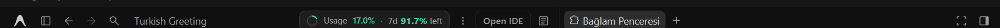
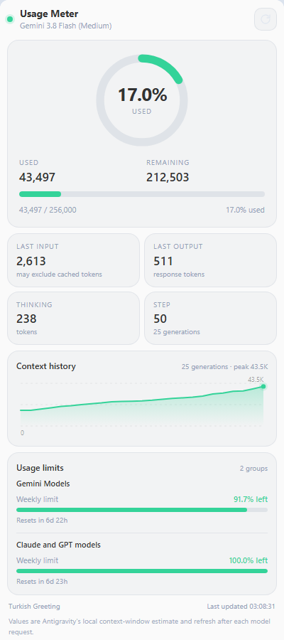

# Usage Meter

**Repository:** [github.com/olcanaskar/antigravity-usage-meter](https://github.com/olcanaskar/antigravity-usage-meter)

A plugin for Antigravity 2.x that shows the active conversation's context-window
token usage and weekly usage limits both in the **chat header** and in the
**side panel**. Values come from Antigravity's own language server; the plugin
does not estimate chat length.



## Chat header badge

The badge sits at the top right of the chat header, immediately left of the ⋮
menu:

`● Usage 17.0% · 7d 91.7% left`

- Refreshes every 4 seconds.
- Follows the active conversation from the `/c/<conversationId>` URL; switches
  automatically when you change conversations.
- Color: green up to 70%, amber from 70% to 90%, red at 90% and above for the
  context percentage; the weekly percentage uses the same threshold based on
  the remaining quota.
- The right side shows the active model group's weekly remaining percentage
  (`7d 91.7% left`); the tooltip and panel list every group and window.
- Hover for the model, exact token counts, context percentage, and the full
  usage-limit breakdown.
- Click the badge to open the Usage Meter panel in the auxiliary pane; click
  it again to close the pane. When opening, it focuses the Usage Meter tab.
- Hidden on non-chat screens and in very narrow windows.

> **Note:** Antigravity's official plugin API does not expose a chat-header
> extension point; only aux pane, full pane, and sidebar entrypoints exist. The
> badge is therefore injected into the renderer through the app's local Chrome
> DevTools Protocol (CDP) endpoint. This is an unofficial, best-effort
> integration: a major Antigravity UI update may change its position or make it
> disappear. The panel keeps working. To disable the badge, set
> `env.USAGE_METER_HEADER` to `"0"` in `sidecar.json` and restart the sidecar.

## Panel



The panel also shows:

- Used and remaining tokens.
- Current model, latest step, and generation count.
- Last request's input, output, and thinking tokens.
- A history sparkline of context growth.
- Weekly usage limits for each model group, with remaining percentage, a bar,
  and the reset time.
- An amber warning at 70% and a red warning at 90% for context usage.

## How to open

The quickest way is to click the header badge (click it again to close the
pane).

1. **From chat:** Say "Open the Usage Meter panel" or run `/usage-meter`,
   then click the link:
   [Usage Meter](sidecar://usage-meter/usage-meter/)
2. **From the Extensions menu:** Antigravity top-right **⋮** → **Extensions** →
   **Usage Meter**.
3. The panel opens in the auxiliary side pane. The header badge stays visible
   even when the panel is closed.

## Installation

Download the latest packaged release from the
[Releases page](https://github.com/olcanaskar/antigravity-usage-meter/releases/latest)
and extract it into:

```text
~/.gemini/config/plugins/
```

This creates `~/.gemini/config/plugins/usage-meter/`. Enable it by adding these
entries to `~/.gemini/config/config.json`:

```json
{
  "plugins": {
    "usage-meter": { "enabled": true }
  },
  "sidecars": {
    "usage-meter/usage-meter": { "enabled": true }
  }
}
```

To install on a new machine:

1. Copy this folder to `~/.gemini/config/plugins/usage-meter/`.
2. Add the two entries above to `config.json`.
3. Restart Antigravity.
4. Say "Open the Usage Meter panel", use **⋮ → Extensions**, or check the
   header badge.

## How it works

- `plugin.json` defines the plugin; `sidecars/usage-meter/sidecar.json`
  starts a **UI extension** (sidecar).
- The sidecar connects to Antigravity's local language server using
  `ANTIGRAVITY_LS_ADDRESS` and `ANTIGRAVITY_CSRF_TOKEN`.
- `GetAllCascadeTrajectories` provides the conversation list and titles.
- `GetCascadeTrajectoryGeneratorMetadata` reads each generation's
  `chatModel.chatStartMetadata.contextWindowMetadata` block:
  - `estimatedTokensUsed`: estimated context tokens at the start of that request.
  - `maxContextTokens`: the model's context-window capacity.
- `RetrieveUserQuotaSummary` supplies each model group's weekly quota bucket,
  remaining fraction, and reset time. Quota is cached for 60 seconds.
- The panel serves data through a local HTTP API.
- The header badge finds the CDP port in
  `%APPDATA%\Antigravity\DevToolsActivePort`, then uses `Runtime.evaluate` to
  insert a small badge into the header's button group. Because the badge is part
  of the app's flex layout, it moves with the aux panel instead of lagging. If
  the page re-renders, it is re-inserted automatically.
- No data leaves the machine.

## Notes and limitations

- Values are Antigravity's **estimate**; they may not match the model's
  tokenizer exactly.
- The measurement is taken at the start of each model request. While a response
  streams, the panel and badge show the last completed measurement; the new
  value arrives with the next request.
- The header badge is an unofficial CDP injection; it may break after major
  Antigravity updates. The panel uses the official sidecar mechanism and is
  unaffected.
- Usage percentages are **remaining**, not consumed. The badge shows the active
  model group's weekly bucket; the panel lists every group and window.
- Sidecars are supported by the Antigravity **App** (the IDE/CLI does not render
  this UI panel).
- This language-server RPC is an internal API and may change in major releases.
  The panel shows an error message instead of crashing.
- The badge uses English `en-US` number formatting (`91.7%`, `43.5K`, `17.0%`).

## Uninstall

1. Remove `plugins.usage-meter` and
   `sidecars["usage-meter/usage-meter"]` from
   `~/.gemini/config/config.json`.
2. Delete `~/.gemini/config/plugins/usage-meter/`.
3. Restart Antigravity.

## Development

File layout:

```text
usage-meter/
├── plugin.json
├── assets/logo.svg
├── assets/header-chip.png
├── assets/screenshot.png
├── skills/usage-meter/SKILL.md
└── sidecars/usage-meter/
    ├── sidecar.json
    ├── main.mjs          # local API + language server client
    ├── header-widget.mjs # CDP header badge injection
    ├── index.html
    ├── styles.css
    └── app.js
```

Run the sidecar manually (test):

```powershell
$env:ANTIGRAVITY_LS_ADDRESS='127.0.0.1:61671'
$env:ANTIGRAVITY_CSRF_TOKEN='<csrf-token>'
$env:ANTIGRAVITY_SIDECAR_WEB_PORT='5399'
$env:ANTIGRAVITY_SIDECAR_UI_TOKEN='testtoken'
$env:ANTIGRAVITY_CONVERSATION_ID='<conversation-id>'
$env:USAGE_METER_HEADER='0'
node main.mjs
```

Then open `http://127.0.0.1:5399/?token=testtoken`.

## License

MIT
